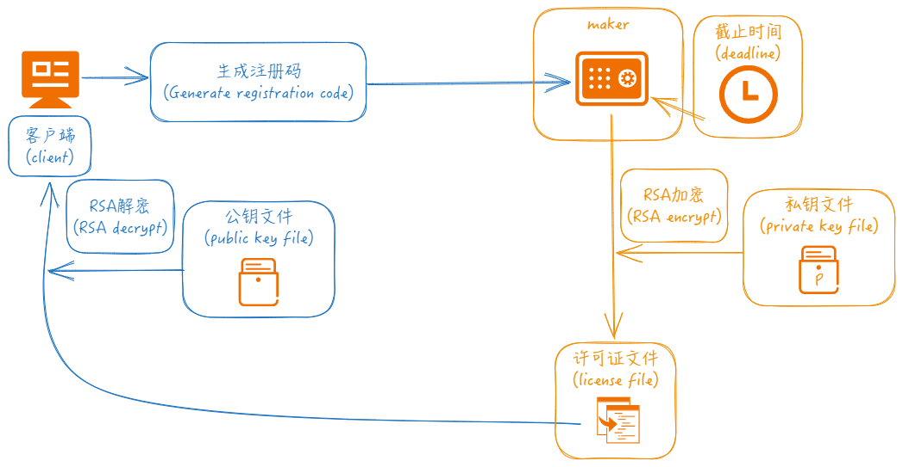

<h4 align="right">简体中文 | <strong><a href="README_en.md">English</a></strong></h4>


### 天佐.混沌钟


||||
|--|--|--|
|操作系统|   ||
|编译器|      ||
|编程语言|          ||
# 简介


**天佐.混沌钟** 保护你开发的软件不受未经授权的拷贝，及时限制使用，只在特定的机器上使用。

**传说:**
乃是上古十大神器之首，被誉为力量最强大的神器。 东皇钟之所被称之为东皇钟，其拥有者便是东皇太一，东皇太一是上古神话中，名列前五的大神，作为其法宝的东皇钟，实力也不赖。相传东皇钟是天界之门，可控日月，能变阴阳，东皇钟是一种防御性很强，攻击力较弱，但是爆发力惊人的法器，一旦爆发真正实力，基本上能够毁天灭地，吞噬诸天。

# 目标
保护你开发的软件不受未经授权的拷贝，及时限制使用，只在特定的机器上使用。



# 功能

- 🧩 集成简单
- 🪢 数据经过算法加密
- 🔒 可按时间限制, 可按设备ID限制, 也可同时限制

# 流程

客户端软件中调用get_machineid接口可以获取到机器码(注册码), 然后通过maker程序输入注册码/截止时间来创建许可证文件, maker生成许可证文件时需要读取私钥文件, 对应的公钥信息在客户端软件中进行输入. 当许可证发布到客户端本地后, 客户端启动调用check接口进行验证. 

1. 生成公钥私钥配对的信息文件.
  
```bash
// 创建私钥文件
(1) openssl genrsa -out privatekey.pem 2048                 

// 根据私钥文件创建对应的公钥文件          
(2) openssl rsa -in privatekey.pem -pubout -out publickey.pem         
```

2. 通过maker命令行创建许可证文件:

```bash
// 仅生成时间限制的许可证文件
maker.exe --type=1 --date="2024-04-30" --keyfile="privatekey.pem"

// 仅生成机器码限制的许可证文件
maker.exe --type=2 --id="9ea03801651cd3d93add9d42a07d3c4b" --keyfile="privatekey.pem"

// 生成同时拥有时间限制和机器码限制的许可证文件
maker.exe --type=3 --date="2024-04-30" --id="9ea03801651cd3d93add9d42a07d3c4b" --keyfile="privatekey.pem"
```


# 例子
<details>
  <summary>cpp</summary>

```cpp
#include <iostream>
#include "../../include/tianzuo.HundunInterface.h" // 接口头文件 interface heaher file

#define Get_Machineid 0

int main() {
	std::string public_key = "-----BEGIN PUBLIC KEY-----\n"
		"MIIBIjANBgkqhkiG9w0BAQEFAAOCAQ8AMIIBCgKCAQEA3I4g6QtToZuQopoS7Myf\n"
		"p1QPSBdC0PWNzG0Ii+oMeEp+aqiiVDU33aIrHgyXcBsDNFyPi3R3USNI9WbyO0cw\n"
		"LrlYS8YRjP6ckz90lZph2VSXCFWXQm7nOqD4P9GC3QMvV3U9XLyLufRiZs0BcYVF\n"
		"ENbm+jt3Z8/ikkFaLh0Mw8Y3ksjJN+Kd2DyEgpj5taLXHShHRyLjWAd102M2J4Id\n"
		"z1hZg3CxyQNN7hQPmsFvZBsOejqAKeSO57/hRgo6IgZHh7iFbIpNyYjj1fxL0T5o\n"
		"ouJ5yHODq8fWQ9ZHmk3po9QtbQJIYXO/ShfladQiZrz74vg6VFjleVyPp9m9gAUn\n"
		"lQIDAQAB\n"
		"-----END PUBLIC KEY-----\n";

	tianzuo_HundunInt hundun;
#if Get_Machineid
	const char* id = hundun.get_machineid();
	if (id == nullptr) {
		std::cerr << "hundun.get_machineid error" << std::endl;
		return -1;
	}
	std::cout << "id: " << id << std::endl;
#else
	int days = 0;
	int error_code = tianzuo_Hundun_check(public_key.c_str(), "license.dat", &days);
	if (error_code != Hundun_error_code_success) {
		std::cout << "hundun.check error_code: " << error_code << " error_string: " << Hundun_error_code_strings_cn[error_code] << std::endl;
		return -1;
	}
	std::cout << "hundun.check days: " << days << std::endl;
#endif
	return 0;
}

```
</details>

<details>
  <summary>python</summary>

```python
from ctypes import *
from enum import Enum
import ctypes


tianzuo_HundunLib = cdll.LoadLibrary('./tianzuo.Hundun.dll')


class Hundun_error_code(Enum):
    Hundun_error_code_success       = 0 # 成功
    Hundun_error_code_parameter     = 1 # 参数错误
    Hundun_error_code_parse         = 2 # 解析错误
    Hundun_error_code_licensefile   = 3 # 许可证文件或路径错误
    Hundun_error_code_outofdate     = 4 # 日期已过
    Hundun_error_code_unmatched     = 5 # 机器码不匹配


def tianzuo_Hundun_check(public_key_string, license_file, days):
    tianzuo_HundunLib.tianzuo_Hundun_check.argtypes = [c_char_p, c_char_p, ctypes.POINTER(ctypes.c_int)]
    return tianzuo_HundunLib.tianzuo_Hundun_check(public_key_string, license_file, days)


def main():
    public_key = (b"-----BEGIN PUBLIC KEY-----\n"
                  b"MIIBIjANBgkqhkiG9w0BAQEFAAOCAQ8AMIIBCgKCAQEA3I4g6QtToZuQopoS7Myf\n"
                  b"p1QPSBdC0PWNzG0Ii+oMeEp+aqiiVDU33aIrHgyXcBsDNFyPi3R3USNI9WbyO0cw\n"
                  b"LrlYS8YRjP6ckz90lZph2VSXCFWXQm7nOqD4P9GC3QMvV3U9XLyLufRiZs0BcYVF\n"
                  b"ENbm+jt3Z8/ikkFaLh0Mw8Y3ksjJN+Kd2DyEgpj5taLXHShHRyLjWAd102M2J4Id\n"
                  b"z1hZg3CxyQNN7hQPmsFvZBsOejqAKeSO57/hRgo6IgZHh7iFbIpNyYjj1fxL0T5o\n"
                  b"ouJ5yHODq8fWQ9ZHmk3po9QtbQJIYXO/ShfladQiZrz74vg6VFjleVyPp9m9gAUn\n"
                  b"lQIDAQAB\n"
                  b"-----END PUBLIC KEY-----\n")

    Hundun_error_code_strings_cn = (
        "成功",
        "参数错误",
        "解析错误",
        "许可证文件或路径错误",
        "日期已过",
        "机器码不匹配")

    Hundun_error_code_strings = (
        "success",
        "parameter error",
        "parse error",
        "license filename error",
        "out of date",
        "machine id unmatched")

    days = ctypes.c_int()
    license_file = b"license.dat"
    error_code = tianzuo_Hundun_check(public_key, license_file, days)
    if error_code != Hundun_error_code.Hundun_error_code_success.value:
        print("hundun.check error_code: {} error_string: {}".format(error_code, Hundun_error_code_strings_cn[error_code]))
        return

    int_days = days.value
    print("hundun.check days: {}".format(int_days))


if __name__ == '__main__':
    main()

```
</details>

<details>
  <summary>java</summary>

```java
package cn.camelsoft;

import com.sun.jna.Library;
import com.sun.jna.Native;

enum Hundun_error_code {
    Hundun_error_code_success       (0),            ///<  成功
    Hundun_error_code_parameter     (1),            ///<  参数错误
    Hundun_error_code_parse         (2),            ///<  解析错误
    Hundun_error_code_licensefile   (3),            ///<  许可证文件或路径错误
    Hundun_error_code_outofdate     (4),            ///<  日期已过
    Hundun_error_code_unmatched     (5);            ///<  机器码不匹配

    private int value;

    Hundun_error_code(int value) {
        this.value = value;
    }

    public int getValue() {
        return value;
    }
}

public class Main {
    public interface tianzuo_HundunLib extends Library {
        tianzuo_HundunLib instance = (tianzuo_HundunLib) Native.load("./tianzuo.Hundun.dll", tianzuo_HundunLib.class);
        int tianzuo_Hundun_check(String public_key_string, String license_file, int[] days);
    }

    public static void main(String[] args) {
        System.setProperty("jna.encoding","UTF-8");

        String public_key = "-----BEGIN PUBLIC KEY-----\n" +
        "MIIBIjANBgkqhkiG9w0BAQEFAAOCAQ8AMIIBCgKCAQEA3I4g6QtToZuQopoS7Myf\n" +
        "p1QPSBdC0PWNzG0Ii+oMeEp+aqiiVDU33aIrHgyXcBsDNFyPi3R3USNI9WbyO0cw\n" +
        "LrlYS8YRjP6ckz90lZph2VSXCFWXQm7nOqD4P9GC3QMvV3U9XLyLufRiZs0BcYVF\n" +
        "ENbm+jt3Z8/ikkFaLh0Mw8Y3ksjJN+Kd2DyEgpj5taLXHShHRyLjWAd102M2J4Id\n" +
        "z1hZg3CxyQNN7hQPmsFvZBsOejqAKeSO57/hRgo6IgZHh7iFbIpNyYjj1fxL0T5o\n" +
        "ouJ5yHODq8fWQ9ZHmk3po9QtbQJIYXO/ShfladQiZrz74vg6VFjleVyPp9m9gAUn\n" +
        "lQIDAQAB\n" +
        "-----END PUBLIC KEY-----\n";

        String[] Hundun_error_code_strings_cn = {"成功",
                "参数错误",
                "解析错误",
                "许可证文件或路径错误",
                "日期已过",
                "机器码不匹配"};

        String[] Hundun_error_code_strings = {
                "success",
                "parameter error",
                "parse error",
                "license filename error",
                "out of date",
                "machine id unmatched"
        };

        int[] days = {0};
        int error_code = tianzuo_HundunLib.instance.tianzuo_Hundun_check(public_key, "license.dat", days);
        if (error_code != Hundun_error_code.Hundun_error_code_success.getValue()) {
            System.out.printf("hundun.check error_code: %d error_string: %s\n", error_code, Hundun_error_code_strings_cn[error_code]);
            return;
        }
        System.out.printf("hundun.check days: : %d\n", days[0]);
    }
}

```
</details>

<details>
  <summary>csharp</summary>

```csharp


using System.Runtime.InteropServices;

class Program {
    [DllImport("tianzuo.Hundun.dll")]
    public static extern int tianzuo_Hundun_check(string public_key_string, string license_file, ref int days);

    public enum Hundun_error_code
    {
        Hundun_error_code_success,                ///<  成功
        Hundun_error_code_parameter,              ///<  参数错误
        Hundun_error_code_parse,                  ///<  解析错误
        Hundun_error_code_licensefile,            ///<  许可证文件或路径错误
        Hundun_error_code_outofdate,              ///<  日期已过
        Hundun_error_code_unmatched               ///<  机器码不匹配
    }

    public string[] Hundun_error_code_strings_cn = {
        "成功",
        "参数错误",
        "解析错误",
        "许可证文件或路径错误",
        "日期已过",
        "机器码不匹配"
    };

    public string[] Hundun_error_code_strings = {
        "success",
        "parameter error",
        "parse error",
        "license filename error",
        "out of date",
        "machine id unmatched"
    };

    static void Main(string[] args) {
        string public_key = "-----BEGIN PUBLIC KEY-----\n" +
            "MIIBIjANBgkqhkiG9w0BAQEFAAOCAQ8AMIIBCgKCAQEA3I4g6QtToZuQopoS7Myf\n" +
            "p1QPSBdC0PWNzG0Ii+oMeEp+aqiiVDU33aIrHgyXcBsDNFyPi3R3USNI9WbyO0cw\n" +
            "LrlYS8YRjP6ckz90lZph2VSXCFWXQm7nOqD4P9GC3QMvV3U9XLyLufRiZs0BcYVF\n" +
            "ENbm+jt3Z8/ikkFaLh0Mw8Y3ksjJN+Kd2DyEgpj5taLXHShHRyLjWAd102M2J4Id\n" +
            "z1hZg3CxyQNN7hQPmsFvZBsOejqAKeSO57/hRgo6IgZHh7iFbIpNyYjj1fxL0T5o\n" +
            "ouJ5yHODq8fWQ9ZHmk3po9QtbQJIYXO/ShfladQiZrz74vg6VFjleVyPp9m9gAUn\n" +
            "lQIDAQAB\n" +
            "-----END PUBLIC KEY-----\n";

        int days = 0;
        int error_code = tianzuo_Hundun_check(public_key, "license.dat", ref days);
        if (error_code != (int)Hundun_error_code.Hundun_error_code_success)
        {
            Program myProgram = new Program();
            Console.WriteLine("hundun.check error_code: " + error_code + " error_string: " + myProgram.Hundun_error_code_strings_cn[error_code]);
            return;
        }
        Console.WriteLine("hundun.check days: " + days);

    }

}
```
</details>

<details>
  <summary>javascript</summary>

```js

Hundun_error_code_success     = 0 //  成功
Hundun_error_code_parameter   = 1 //  参数错误
Hundun_error_code_parse       = 2 //  解析错误
Hundun_error_code_licensefile = 3 //  许可证文件或路径错误
Hundun_error_code_outofdate   = 4 //  日期已过
Hundun_error_code_unmatched   = 5 //  机器码不匹配

let ffi = require('ffi-napi')
const ref = require('ref-napi');

let tianzuo_HundunLib = ffi.Library("tianzuo.Hundun.dll", {
    'tianzuo_Hundun_check':['int',['string','string','pointer']],
})

let public_key = "-----BEGIN PUBLIC KEY-----\n" +
"MIIBIjANBgkqhkiG9w0BAQEFAAOCAQ8AMIIBCgKCAQEA3I4g6QtToZuQopoS7Myf\n" +
"p1QPSBdC0PWNzG0Ii+oMeEp+aqiiVDU33aIrHgyXcBsDNFyPi3R3USNI9WbyO0cw\n" +
"LrlYS8YRjP6ckz90lZph2VSXCFWXQm7nOqD4P9GC3QMvV3U9XLyLufRiZs0BcYVF\n" +
"ENbm+jt3Z8/ikkFaLh0Mw8Y3ksjJN+Kd2DyEgpj5taLXHShHRyLjWAd102M2J4Id\n" +
"z1hZg3CxyQNN7hQPmsFvZBsOejqAKeSO57/hRgo6IgZHh7iFbIpNyYjj1fxL0T5o\n" +
"ouJ5yHODq8fWQ9ZHmk3po9QtbQJIYXO/ShfladQiZrz74vg6VFjleVyPp9m9gAUn\n" +
"lQIDAQAB\n" +
"-----END PUBLIC KEY-----\n";

const Hundun_error_code_strings_cn = [
    "成功",
    "参数错误",
    "解析错误",
    "许可证文件或路径错误",
    "日期已过",
    "机器码不匹配"];

const Hundun_error_code_strings = [
    "success",
    "parameter error",
    "parse error",
    "license filename error",
    "out of date",
    "machine id unmatched"];

days = Buffer.alloc(1 * ref.sizeof.int);
let error_code = tianzuo_HundunLib.tianzuo_Hundun_check(public_key, "license.dat", days);
if (error_code !== Hundun_error_code_success) {
    console.log("hundun.check error_code: %d error_string: %s\n", error_code, Hundun_error_code_strings_cn[error_code]);
    return -1;
}
days_data = ref.get(days, 0, ref.types.int);
console.log("hundun.check days: %d\n", days_data);

```
</details>

<details>
  <summary>php</summary>

```php
<?php

// 检查是否加载了 FFI 扩展
if (extension_loaded('ffi')) {
    echo("已启用 FFI 扩展\n");
} else {
    die("未启动 FFI 扩展\n");
}

enum Hundun_error_code
{
    const Hundun_error_code_success = 0;        //  成功
    const Hundun_error_code_parameter = 1;      //  参数错误
    const Hundun_error_code_parse = 2;          //  解析错误
    const Hundun_error_code_licensefile = 3;    //  许可证文件或路径错误
    const Hundun_error_code_outofdate = 4;      //  日期已过
    const Hundun_error_code_unmatched = 5;      //  机器码不匹配
}

$ffi = FFI::cdef("
    int tianzuo_Hundun_check(const char* public_key_string, const char* license_file, int* days);
", "tianzuo.Hundun.dll");

$public_key = "-----BEGIN PUBLIC KEY-----
MIIBIjANBgkqhkiG9w0BAQEFAAOCAQ8AMIIBCgKCAQEA3I4g6QtToZuQopoS7Myf
p1QPSBdC0PWNzG0Ii+oMeEp+aqiiVDU33aIrHgyXcBsDNFyPi3R3USNI9WbyO0cw
LrlYS8YRjP6ckz90lZph2VSXCFWXQm7nOqD4P9GC3QMvV3U9XLyLufRiZs0BcYVF
ENbm+jt3Z8/ikkFaLh0Mw8Y3ksjJN+Kd2DyEgpj5taLXHShHRyLjWAd102M2J4Id
z1hZg3CxyQNN7hQPmsFvZBsOejqAKeSO57/hRgo6IgZHh7iFbIpNyYjj1fxL0T5o
ouJ5yHODq8fWQ9ZHmk3po9QtbQJIYXO/ShfladQiZrz74vg6VFjleVyPp9m9gAUn
lQIDAQAB
-----END PUBLIC KEY-----\n";

define('Hundun_error_code_strings_cn', [
    "成功",
    "参数错误",
    "解析错误",
    "许可证文件或路径错误",
    "日期已过",
    "机器码不匹配"]);

define('Hundun_error_code_strings', [
    "success",
    "parameter error",
    "parse error",
    "license filename error",
    "out of date",
    "machine id unmatched"
]);

$days = FFI::new("int");
$error_code = $ffi->tianzuo_Hundun_check($public_key, "license.dat", FFI::addr($days));
if ($error_code != Hundun_error_code::Hundun_error_code_success) {
    echo "hundun.check error_code: " . $error_code . " error_string: " . Hundun_error_code_strings_cn[$error_code] . "\n";
    return;
}
echo "hundun.check days: " . $days->cdata . "\n";

?>
```
</details>

<details>
  <summary>vb</summary>

```vb

Imports System.Runtime.InteropServices

Enum Hundun_error_code
    Hundun_error_code_success = 0 '  成功
    Hundun_error_code_parameter = 1 '  参数错误
    Hundun_error_code_parse = 2 '  解析错误
    Hundun_error_code_licensefile = 3 '  许可证文件或路径错误
    Hundun_error_code_outofdate = 4 '  日期已过
    Hundun_error_code_unmatched = 5 '  机器码不匹配
End Enum

Module Program
    <DllImport("tianzuo.Hundun.dll")>
    Public Function tianzuo_Hundun_check(public_key_string As String, license_file As String, ByRef days As Integer) As Integer
    End Function

    ReadOnly Hundun_error_code_strings_cn() As String = {
        "成功",
        "参数错误",
        "解析错误",
        "许可证文件或路径错误",
        "日期已过",
        "机器码不匹配"}

    ReadOnly Hundun_error_code_strings() As String = {
        "success",
        "parameter error",
        "parse error",
        "license filename error",
        "out of date",
        "machine id unmatched"}

    Sub Main(args As String())
        Dim public_key As String = "-----BEGIN PUBLIC KEY-----
MIIBIjANBgkqhkiG9w0BAQEFAAOCAQ8AMIIBCgKCAQEA3I4g6QtToZuQopoS7Myf
p1QPSBdC0PWNzG0Ii+oMeEp+aqiiVDU33aIrHgyXcBsDNFyPi3R3USNI9WbyO0cw
LrlYS8YRjP6ckz90lZph2VSXCFWXQm7nOqD4P9GC3QMvV3U9XLyLufRiZs0BcYVF
ENbm+jt3Z8/ikkFaLh0Mw8Y3ksjJN+Kd2DyEgpj5taLXHShHRyLjWAd102M2J4Id
z1hZg3CxyQNN7hQPmsFvZBsOejqAKeSO57/hRgo6IgZHh7iFbIpNyYjj1fxL0T5o
ouJ5yHODq8fWQ9ZHmk3po9QtbQJIYXO/ShfladQiZrz74vg6VFjleVyPp9m9gAUn
lQIDAQAB
-----END PUBLIC KEY-----"

        Dim license_file As String = "license.dat"
        Dim days As Integer = 0
        Dim error_code As Integer = tianzuo_Hundun_check(public_key, license_file, days)
        If (error_code <> Hundun_error_code.Hundun_error_code_success) Then
            Console.WriteLine("hundun.check error_code: " + error_code.ToString + " error_string: " + Hundun_error_code_strings_cn(error_code))
            Return
        End If

        Console.WriteLine("hundun.check days:" + days.ToString)
    End Sub
End Module

```
</details>

<details>
  <summary>go</summary>

```go
package main

/*
#include "tianzuo.HundunInterface.h"
*/
import "C"
import (
	"fmt"
	"syscall"
	"unsafe"
)

const (
	Hundun_error_code_success     = 0 //  成功
	Hundun_error_code_parameter   = 1 //  参数错误
	Hundun_error_code_parse       = 2 //  解析错误
	Hundun_error_code_licensefile = 3 //  许可证文件或路径错误
	Hundun_error_code_outofdate   = 4 //  日期已过
	Hundun_error_code_unmatched   = 5 //  机器码不匹配
)

func main() {
	const public_key string = "-----BEGIN PUBLIC KEY-----\n" +
		"MIIBIjANBgkqhkiG9w0BAQEFAAOCAQ8AMIIBCgKCAQEA3I4g6QtToZuQopoS7Myf\n" +
		"p1QPSBdC0PWNzG0Ii+oMeEp+aqiiVDU33aIrHgyXcBsDNFyPi3R3USNI9WbyO0cw\n" +
		"LrlYS8YRjP6ckz90lZph2VSXCFWXQm7nOqD4P9GC3QMvV3U9XLyLufRiZs0BcYVF\n" +
		"ENbm+jt3Z8/ikkFaLh0Mw8Y3ksjJN+Kd2DyEgpj5taLXHShHRyLjWAd102M2J4Id\n" +
		"z1hZg3CxyQNN7hQPmsFvZBsOejqAKeSO57/hRgo6IgZHh7iFbIpNyYjj1fxL0T5o\n" +
		"ouJ5yHODq8fWQ9ZHmk3po9QtbQJIYXO/ShfladQiZrz74vg6VFjleVyPp9m9gAUn\n" +
		"lQIDAQAB\n" +
		"-----END PUBLIC KEY-----\n"

	Hundun_error_code_strings_cn := [6]string{
		"成功",
		"参数错误",
		"解析错误",
		"许可证文件或路径错误",
		"日期已过",
		"机器码不匹配"}

	//Hundun_error_code_strings := [6]string{
	//	"success",
	//	"parameter error",
	//	"parse error",
	//	"license filename error",
	//	"out of date",
	//	"machine id unmatched"}

	dll := syscall.MustLoadDLL("tianzuo.Hundun.dll")
	tianzuo_Hundun_check := dll.MustFindProc("tianzuo_Hundun_check")
	days := C.int(0)
	pub_key := C.CString(public_key)
	license_file := C.CString("license.dat")
	error_code, _, _ := tianzuo_Hundun_check.Call(uintptr(unsafe.Pointer(pub_key)), uintptr(unsafe.Pointer(license_file)), uintptr(unsafe.Pointer(&days)))
	if error_code != Hundun_error_code_success {
		fmt.Println("hundun.check error_code: ", error_code, " error_string: ", Hundun_error_code_strings_cn[error_code])
		return
	}
	fmt.Println("hundun.check days: ", days)
}

```
</details>

<details>
  <summary>rust</summary>

```rust

use std::os::raw::c_char;
use std::ffi::{c_int};
use std::ffi::CString;

#[link(name = "tianzuo.Hundun")]
extern {
    fn tianzuo_Hundun_check(public_key_string: *const c_char, license_file: *const c_char, days: *const c_int) -> c_int;
}

const Hundun_error_code_strings_cn: [&str; 6] = [
    "成功",
    "参数错误",
    "解析错误",
    "许可证文件或路径错误",
    "日期已过",
    "机器码不匹配"];

const Hundun_error_code_strings: [&str; 6] = [
    "success",
    "parameter error",
    "parse error",
    "license filename error",
    "out of date",
    "machine id unmatched"];

fn main() {
    unsafe {
        let public_key = CString::new(String::from("-----BEGIN PUBLIC KEY-----\n\
        MIIBIjANBgkqhkiG9w0BAQEFAAOCAQ8AMIIBCgKCAQEA3I4g6QtToZuQopoS7Myf\n\
        p1QPSBdC0PWNzG0Ii+oMeEp+aqiiVDU33aIrHgyXcBsDNFyPi3R3USNI9WbyO0cw\n\
        LrlYS8YRjP6ckz90lZph2VSXCFWXQm7nOqD4P9GC3QMvV3U9XLyLufRiZs0BcYVF\n\
        ENbm+jt3Z8/ikkFaLh0Mw8Y3ksjJN+Kd2DyEgpj5taLXHShHRyLjWAd102M2J4Id\n\
        z1hZg3CxyQNN7hQPmsFvZBsOejqAKeSO57/hRgo6IgZHh7iFbIpNyYjj1fxL0T5o\n\
        ouJ5yHODq8fWQ9ZHmk3po9QtbQJIYXO/ShfladQiZrz74vg6VFjleVyPp9m9gAUn\n\
        lQIDAQAB\n\
        -----END PUBLIC KEY-----\n")).expect("Failed to create CString");


        let license_file = CString::new(String::from("license.dat")).expect("Failed to create CString");
        let mut days: c_int = 0;
        let error_code = tianzuo_Hundun_check(public_key.as_ptr(), license_file.as_ptr(), &mut days);
        if 0 != error_code {
            let errorc: usize =  error_code as usize;
            println!("hundun.check error_code: {:?} error_string: {:?}", error_code, Hundun_error_code_strings_cn[errorc]);
        }

        println!("hundun.check days: {:?}", days);
    }
}

```
</details>

<details>
  <summary>ruby</summary>

```ruby
require 'fiddle'

lib = Fiddle::dlopen('C:/Users/zhengtianzuo/RubymineProjects/tianzuo.HundunTest/tianzuo.Hundun.dll')
tianzuo_Hundun_check = Fiddle::Function.new(lib['tianzuo_Hundun_check'], [Fiddle::TYPE_VOIDP, Fiddle::TYPE_VOIDP, Fiddle::TYPE_VOIDP], Fiddle::TYPE_INT)

public_key = "-----BEGIN PUBLIC KEY-----
MIIBIjANBgkqhkiG9w0BAQEFAAOCAQ8AMIIBCgKCAQEA3I4g6QtToZuQopoS7Myf
p1QPSBdC0PWNzG0Ii+oMeEp+aqiiVDU33aIrHgyXcBsDNFyPi3R3USNI9WbyO0cw
LrlYS8YRjP6ckz90lZph2VSXCFWXQm7nOqD4P9GC3QMvV3U9XLyLufRiZs0BcYVF
ENbm+jt3Z8/ikkFaLh0Mw8Y3ksjJN+Kd2DyEgpj5taLXHShHRyLjWAd102M2J4Id
z1hZg3CxyQNN7hQPmsFvZBsOejqAKeSO57/hRgo6IgZHh7iFbIpNyYjj1fxL0T5o
ouJ5yHODq8fWQ9ZHmk3po9QtbQJIYXO/ShfladQiZrz74vg6VFjleVyPp9m9gAUn
lQIDAQAB
-----END PUBLIC KEY-----"

Hundun_error_code_strings_cn = [
  "成功",
  "参数错误",
  "解析错误",
  "许可证文件或路径错误",
  "日期已过",
  "机器码不匹配"]

Hundun_error_code_strings = [
  "success",
  "parameter error",
  "parse error",
  "license filename error",
  "out of date",
  "machine id unmatched"]

license_file = "license.dat"
days = Fiddle::Pointer.malloc(Fiddle::SIZEOF_INT)
error_code = tianzuo_Hundun_check.call(public_key, license_file, days)
if error_code != 0
  print("hundun.check error_code: ", error_code, " error_string:", Hundun_error_code_strings_cn[error_code] ," \n")
  return
end

int_days = days[0, Fiddle::SIZEOF_INT].unpack('I')[0]
print("hundun.check days: ", int_days, "\n")

```
</details>

# 下载

|||||
|--|--|--|--|
|[](https://github.com/zhengtianzuo/tianzuo.Hundun/releases)|[](https://gitee.com/zhengtianzuo/tianzuo.Hundun/releases)|[](https://pan.baidu.com/s/1MMBny5AbKTfKn0hWjV5BEw?pwd=1234)|[](https://share.weiyun.com/TtFiXpyV)|


# 关于
## 联系方式

||||
|--|--|--|
|作者|郑天佐||
|QQ|278969898||
|邮箱|camelsoft@163.com||
|主页|[http://www.camelstudio.cn](http://www.camelstudio.cn)||
|博客|[http://blog.csdn.net/zhengtianzuo06](http://blog.csdn.net/zhengtianzuo06)||
|github|[https://github.com/zhengtianzuo](https://github.com/zhengtianzuo)||
|gitee|[https://gitee.com/zhengtianzuo](https://gitee.com/zhengtianzuo)||
|QQ群|199672080||


|||||
|--|--|--|--|
|加QQ好友|加微信好友|微信打赏|支付宝打赏|


